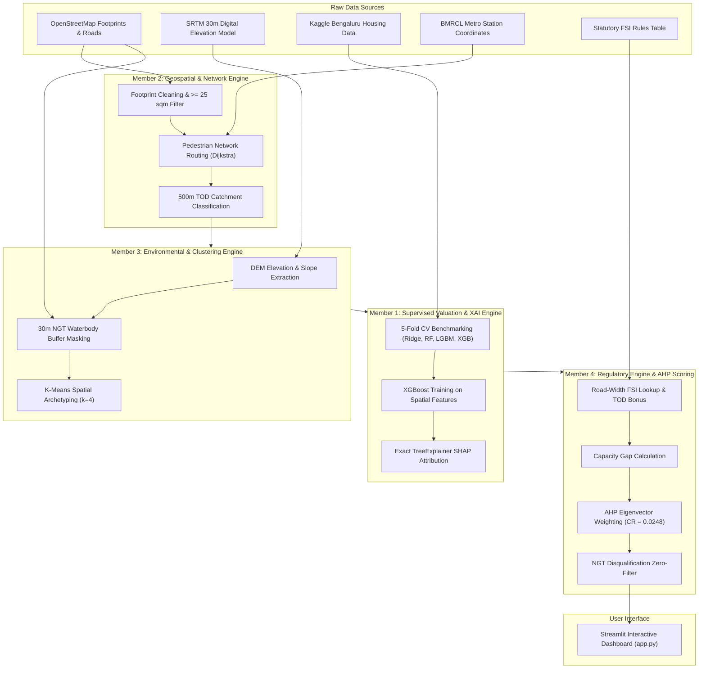
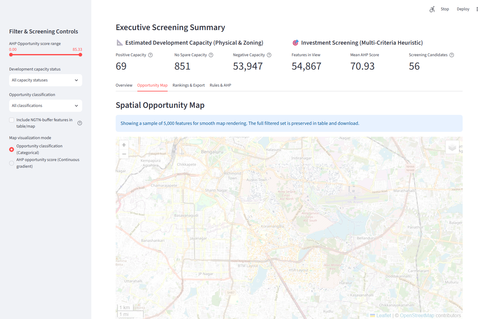
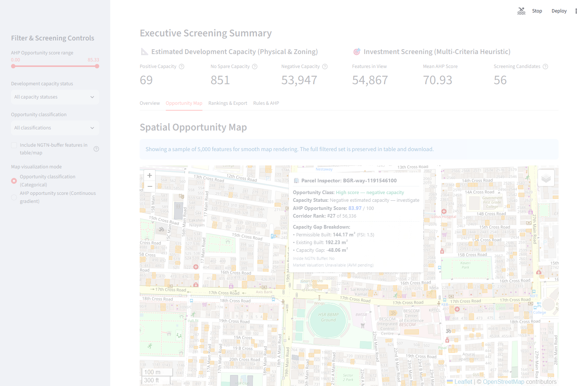
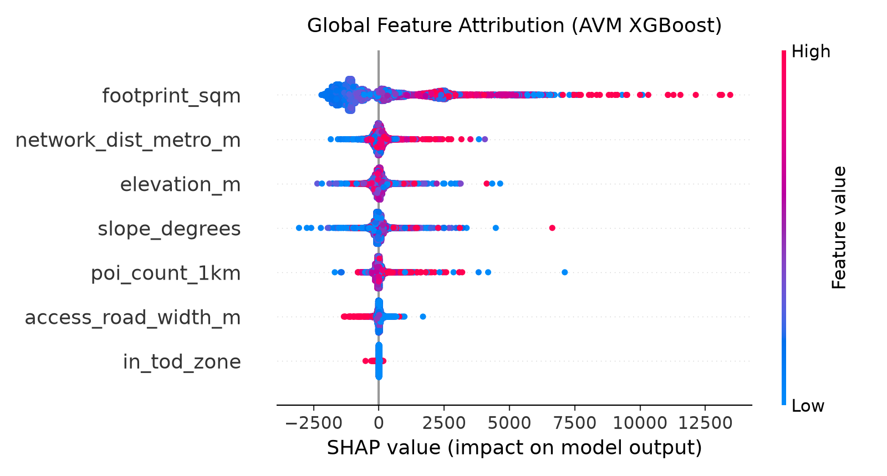

# AI-Powered Land Intelligence Platform for Urban Infill and Transit-Oriented Redevelopment

[](https://www.python.org/)
[](https://streamlit.io/)
[](LICENSE)

An end-to-end geospatial machine learning and decision-support system designed to identify, evaluate, and rank high-potential land redevelopment and transit-oriented infill opportunities across the Koramangala–HSR Layout–Bellandur urban corridor in Bengaluru, India.

Developed as a Semester-5 Machine Learning team project at VIT Chennai.

---

## Overview

Rapid urbanisation across Bengaluru has created intense competition for developable land while generating substantial volumetric capacity gaps along high-capacity mass transit corridors. Traditional site selection relies on fragmented feasibility studies that either model regional expansion without parcel-level property economics, evaluate real estate prices without statutory zoning constraints, or treat spatial planning as a black box.

This platform bridges these disciplines into a unified decision engine. Operating over a 48.7 km² study corridor spanning Koramangala, HSR Layout, and Bellandur, the system processes 56,336 individual spatial units to evaluate pedestrian transit accessibility, statutory Floor Space Index (FSI) capacity headroom, topographic flood risk, unsupervised morphological archetypes, and tree-boosted automated valuation with SHAP interpretability, culminating in an Analytic Hierarchy Process (AHP) composite opportunity ranking.

---

## Key Features

* **Network-Based Metro Accessibility:** Computes walking-network distances from parcel centroids to operational and under-construction BMRCL Namma Metro stations using multi-source Dijkstra shortest-path algorithms over the OpenStreetMap pedestrian network, delineating 500 m Transit-Oriented Development (TOD) catchment zones.
* **National Green Tribunal (NGT) 30 m Lake-Buffer Filter:** Implements an automated environmental disqualification gate where any spatial unit intersecting the statutory 30 m buffer around mapped lake and waterbody boundaries is assigned an opportunity score of zero.
* **Statutory FSI Capacity Gap Analysis:** Evaluates development headroom by calculating permissible built area (based on access road width and TOD bonus FSI) minus existing built area (derived from building footprint geometry and observed/imputed floor counts).
* **Automated Valuation Model (AVM) with Explainable AI (SHAP):** Benchmarks regularised regression, Random Forest, LightGBM, and XGBoost on micro-market housing data, deploying a tuned XGBoost regressor alongside exact TreeExplainer SHAP feature attribution.
* **Unsupervised Spatial Archetyping (K-Means):** Groups parcels into four morphologically distinct clusters based on geometric scale, transit proximity, amenity density, and topographic slope.
* **Mathematically Consistent AHP Scoring:** Synthesises five conflicting planning criteria into a single composite score using eigenvector weighting with a verified Consistency Ratio ($\text{CR} = 0.0248 < 0.10$).
* **Interactive Streamlit Dashboard:** Provides real-time spatial filtering by score range, capacity status, and planning classification, supported by interactive Folium/Leaflet map rendering and candidate export utilities.

---

## Architecture



---

## Repository Structure

```text
land-intelligence-platform/
├── README.md                           # Project documentation and reproduction guide
├── LICENSE                             # MIT License
├── requirements.txt                    # Pinned dependencies from active environment
├── .gitignore                          # Excludes venvs, caches, large rasters & GeoJSONs
├── config.py                           # Root compatibility configuration module
├── schema.py                           # Canonical cross-member feature schema contract
├── app.py                              # Streamlit interactive spatial dashboard
├── src/
│   ├── __init__.py                     # Package initialiser
│   ├── config.py                       # Member 2 BBox and configuration helpers
│   ├── schema.py                       # Member 2 schema validators
│   ├── member1_supervised_avm.py       # AVM cross-validation, training, and SHAP
│   ├── member3_clustering.py           # K-Means clustering and diagnostic elbow plots
│   ├── member3_environment.py          # DEM terrain analysis and NGT buffer masking
│   └── member4_regulatory_ahp.py       # FSI capacity gap and AHP multi-criteria scoring
├── tests/
│   └── test_member4_regulatory_ahp.py  # Member 4 unit tests
├── data/
│   ├── README.md                       # Data inventory, download URLs, and ODbL attributions
│   ├── external/
│   │   └── fsi_rules_table.json        # Illustrative statutory FSI lookup table
│   ├── processed/
│   │   ├── .gitkeep                    # Directory preservation
│   │   ├── member2_validation_report.json # Parcel filtering validation summary
│   │   └── member4_diagnostics.json    # AHP weights and consistency diagnostics
│   └── raw/
│       ├── metro_stations.csv          # BMRCL metro station coordinates
│       └── osm_water_bodies.geojson    # OpenStreetMap water body polygons
├── models/
│   ├── avm_xgboost.json                # Serialised XGBoost valuation model
│   ├── kmeans_model.pkl                # Serialised K-Means clustering model (k=4)
│   ├── cluster_validation.png          # Silhouette, Davies-Bouldin & Inertia chart
│   ├── shap_summary_plot.png           # Global SHAP feature importance plot
│   └── shap_waterfall_sample.png       # Local SHAP waterfall explanation sample
└── docs/
    ├── test_member2.py                 # Member 2 test specification (reference only)
    └── screenshots/
        ├── dashboard_overview.png      # Dashboard map and metrics overview
        ├── dashboard_inspector_panel.png # Parcel inspector and capacity breakdown
        ├── dashboard_filters.png       # Metric filtering and candidate screening
        ├── dashboard_ngt_disqualified.png # NGT 30 m buffer disqualified parcels
        └── dashboard_low_opportunity_inspector.png # Disqualified parcel inspector detail
```

---

## Visualizations & Screenshots

### Dashboard Overview

*Executive screening summary showing portfolio capacity distribution, mean opportunity score, and spatial map rendering.*

### Parcel Inspector & Capacity Breakdown

*Interactive inspector panel detailing permissible vs. existing built area, capacity gap, and corridor ranking.*

### Global SHAP Feature Importance

*TreeExplainer SHAP attribution across AVM features highlighting road width, network distance to transit, and footprint area.*

---

## Getting Started

### Prerequisites

* Python 3.11, 3.12, 3.13, or 3.14
* Git and Git LFS (if cloning large assets)

### Installation

1. **Clone the repository:**
   ```bash
   git clone https://github.com/Smeetmehta27/land-intelligence-platform.git
   cd land-intelligence-platform
   ```

2. **Create and activate a virtual environment:**
   ```bash
   python -m venv .venv
   # Windows (PowerShell)
   .\.venv\Scripts\Activate.ps1
   # Linux / macOS
   source .venv/bin/activate
   ```

3. **Install dependencies:**
   ```bash
   pip install -r requirements.txt
   ```

### Data Setup

To keep the repository lightweight and conform to GitHub file limits, large spatial datasets (> 50 MB) and third-party tabular files are excluded from Git:

1. **Primary Dashboard GeoJSON (`parcels_scored_final.geojson`):**
   The interactive dashboard requires `data/processed/parcels_scored_final.geojson` (71.8 MB). Download this file from the GitHub Releases page:
   ```text
   Download from: https://github.com/Smeetmehta27/land-intelligence-platform/releases/download/v1.0.0/parcels_scored_final.geojson
   Destination:   data/processed/parcels_scored_final.geojson
   ```
   *(Note: If setting up for the first time, upload your local scored GeoJSON to your GitHub Releases under the `v1.0.0` tag).*

2. **Raw Datasets (Optional for model review):**
   * **Kaggle Housing Data:** Download [Kaggle Bengaluru House Price Data](https://www.kaggle.com/datasets/amitabhst/bengaluru-house-price-data) and place it in `data/raw/bgr_house_prices_kaggle.csv`.
   * **SRTM Elevation Model:** Download the 30 m SRTM DEM tile covering Bengaluru and place it in `data/raw/srtm_dem_bgr.tif`.
   * For complete lineage and licensing information, see [data/README.md](data/README.md).

### Running the Application

Launch the Streamlit interactive spatial dashboard:
```bash
streamlit run app.py
```
Open `http://localhost:8501` in your web browser.

### Running Tests

Execute the automated test suite:
```bash
pytest tests
```

*Test Execution Status:* Running `pytest tests` executes `tests/test_member4_regulatory_ahp.py`. Currently, the 3 unit tests fail due to test harness function signature mismatches against the Member 4 script implementation (`TypeError: missing required argument 'matrix'` and `AttributeError: module has no attribute 'load_rules'`). `test_member2.py` has been archived to `docs/test_member2.py` because the upstream Member 2 module was not included in this repository.

---

## Results Summary

All metrics below are derived directly from the project's diagnostic outputs (`member2_validation_report.json`, `member4_diagnostics.json`, `models/avm_xgboost.json`, and project evaluation logs):

### 1. Spatial & Environmental Filtering
* **Raw Footprints Evaluated:** 57,364 building polygons from OpenStreetMap.
* **Area Filter (< 25 m²):** 1,028 micro-structures excluded.
* **Validated Parcel Cohort:** 56,336 units (minimum validated area: 25.01 m²).
* **NGT 30 m Buffer Disqualifications:** 1,469 parcels located inside the statutory waterbody protection zone (AHP opportunity score set to 0.00).

### 2. Multi-Criteria AHP Weighting & Consistency
* **Principal Eigenvalue ($\lambda_{\max}$):** 5.1111
* **Consistency Index ($\text{CI}$):** 0.0278 ($\frac{\lambda_{\max} - n}{n - 1}$ for $n=5$)
* **Random Index ($\text{RI}$):** 1.12
* **Consistency Ratio ($\text{CR}$):** 0.0248 (passes Saaty's consistency threshold: $\text{CR} < 0.10$)

| Criterion | Planning Factor | Mathematical Weight ($w_i$) | Percentage |
| :--- | :--- | :--- | :--- |
| $C_1$ | Volumetric Capacity Gap ($\text{m}^2$) | 0.3982 | 39.82% |
| $C_2$ | Market Price Estimate ($\text{INR/sq.ft}$) | 0.2422 | 24.22% |
| $C_3$ | Metro Walking Network Distance ($\text{m}$) | 0.1693 | 16.93% |
| $C_4$ | POI Amenity Density (1 km count) | 0.1183 | 11.83% |
| $C_5$ | Environmental Hazard Risk Index | 0.0720 | 7.20% |

### 3. Automated Valuation Model (AVM) 5-Fold Cross-Validation
Trained on 13,320 Bengaluru real estate sales listings:

| Model Algorithm | Architecture Type | $R^2$ Score | MAE (INR/sq.ft) | RMSE (INR/sq.ft) | MAPE (%) |
| :--- | :--- | :--- | :--- | :--- | :--- |
| **Ridge Regression** | L2-Regularised Linear | 0.0489 | ₹2,561.12 | ₹4,014.15 | 40.95% |
| **Random Forest** | Bagging Ensemble | 0.1440 | ₹2,385.00 | ₹3,810.20 | ~38.0% |
| **LightGBM** | Leaf-Wise Gradient Boosting | 0.1564 | ₹2,368.91 | ₹3,780.50 | 37.75% |
| **XGBoost** | Depth-Wise 2nd-Order Boosting | 0.1359 | ₹2,390.58 | ₹3,825.94 | 38.21% |

### 4. Morphological Clustering (K-Means)
* **Optimal Clusters ($k$):** 4 (selected via inflection knee analysis).
* **Davies-Bouldin Index:** 1.41
* **Inertia:** 181,464.52

---

## Known Limitations

Transparency regarding methodological constraints is essential for municipal and real estate due diligence:

1. **Missing Upstream Pipeline Code:** `src/member2_geospatial.py` and the pipeline orchestration runner (`run_pipeline.py`) are not included in this repository. Upstream spatial processing outputs are loaded from pre-generated files.
2. **OSM Building Footprint Proxy for Parcels:** Cadastral parcel boundary data was unavailable. OpenStreetMap building footprints were used as the spatial parcel unit. Consequently, the measured parcel area equals the ground-floor footprint, causing approximately 98% of parcels to register negative development capacity gaps because multi-storey existing built area exceeds single-level allowable zoning envelopes.
3. **AVM Geographic Imprecision:** Housing listings in the Kaggle dataset contain neighborhood names rather than geographic coordinates. Listings were assigned neighborhood-median spatial features, constraining cross-validation $R^2$ to ~0.14 and Mean Absolute Percentage Error (MAPE) to ~38%.
4. **Scored Output Price Sub-score:** The final scored GeoJSON (`parcels_scored_final.geojson`) assigned a neutral fallback sub-score of 0.5 to the price factor because AVM model predictions were not joined to spatial geometries prior to Member 4's execution.
5. **Static Cluster Label Mapping:** In the clustering module, the assigned `label_map` is static and does not correspond to the true empirical cluster centroids (Cluster 3 corresponds to the dense commercial core, while Cluster 1 corresponds to the high-hazard group).
6. **Illustrative FSI Rules:** Thresholds and FSI ratios in `data/external/fsi_rules_table.json` are demonstrative examples and have not been certified against officially notified Bangalore Development Authority (BDA) or BBMP planning regulations.

---

## Team

| Name | Register Number | Role & Responsibilities |
| :--- | :--- | :--- |
| **Aryan Agarwal** | 24BAI1059 | Member 1: Supervised AVM benchmarking, XGBoost fine-tuning, and TreeExplainer SHAP explainability. |
| **Saideep Keshri** | 24BAI1084 | Member 2: Geospatial feature extraction, footprint validation, and multi-source Dijkstra network routing. |
| **Mehar Bajaj** | 24BAI1120 | Member 3: SRTM DEM topographic processing, 30 m NGT buffer masking, and K-Means spatial clustering. |
| **Smeet Chirag Mehta** | 24BAI1108 | Member 4: Statutory FSI capacity analysis, AHP multi-criteria consistency scoring, and Streamlit dashboard. |

---

## Data Sources & References

* **OpenStreetMap Data:** Building footprints, road network graphs, and waterbodies © [OpenStreetMap contributors](https://www.openstreetmap.org/copyright), licensed under [ODbL](https://opendatacommons.org/licenses/odbl/).
* **Topographic Elevation:** USGS Shuttle Radar Topography Mission (SRTM) 1-arc-second global digital elevation models.
* **Transit Station Data:** Bangalore Metro Rail Corporation Limited (BMRCL) Namma Metro Phase 1 and Phase 2 alignment maps.
* **Real Estate Benchmark:** Kaggle Bengaluru House Price dataset curated by Amitabh Sharma.
* **Planning Framework:** Bangalore Development Authority (BDA) Revised Master Plan 2031 (Draft Guidelines).

---

## License

This project is licensed under the [MIT License](LICENSE) - see the LICENSE file for details.
